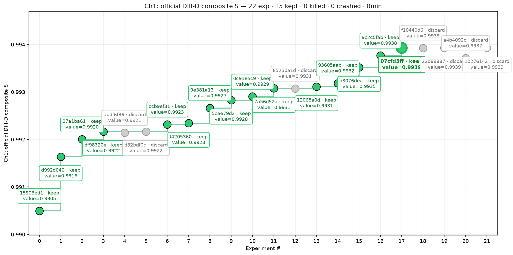
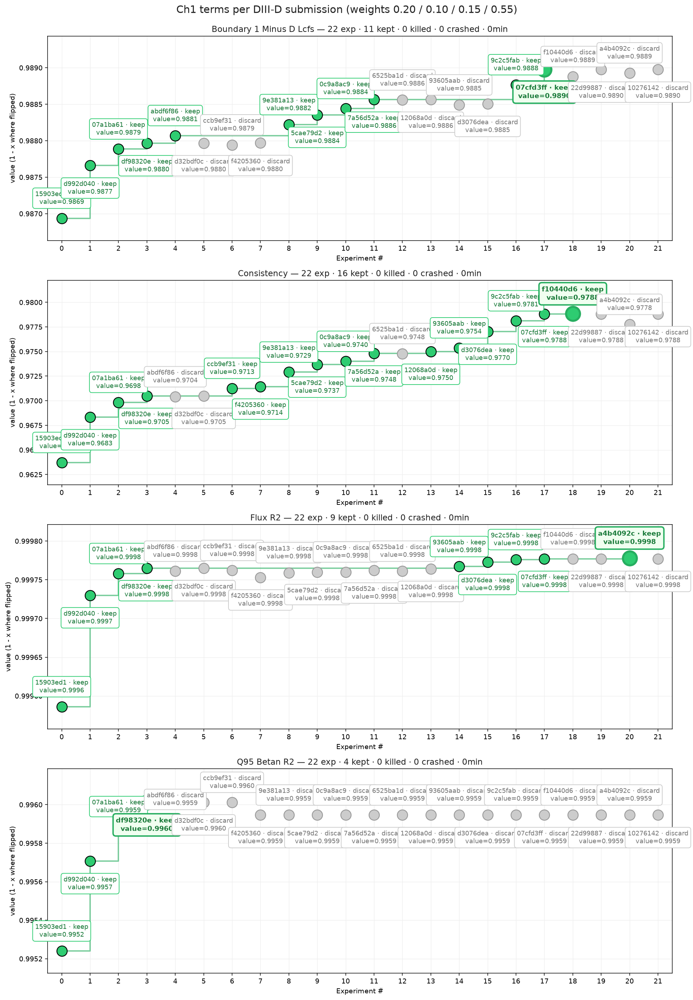
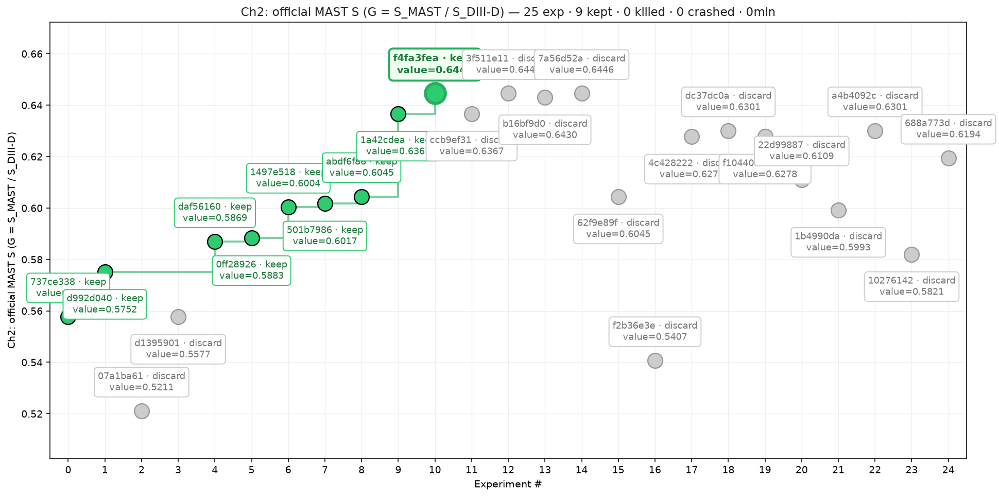

# The experiment journey

How the entry got from the first submission (DIII-D 0.9905, 29 Sep) to 0.993927 (11 Oct), and why MAST sits at
0.628. Each step links to its sweep writeup, design spec or diagnosis; every experiment's baseline, promotion gate,
verdict and PR is in [`verdicts.yaml`](experiments/fusioneq/verdicts.yaml) (rendered in the
[W&B experiment log](https://wandb.ai/chaleong/fusion-equilibrium/reports/Fusion-Equilibrium-Challenge:-experiment-log--VmlldzoxODAxNjExMg==)
and the [dashboard](../report/dashboard.html)).

## Challenge 1: DIII-D

| Phase | Dates | Official S | What moved it | Detail |
|---|---|---|---|---|
| 1. One residual MLP | 28-29 Sep | 0.9905 | PCA + ridge 0.822 -> MLP on PCA coefficients 0.970 -> bf16, 120 epochs, mixed loss 0.9915 (local) | [v1](experiments/fusioneq/mlp/v1_mlp.md)-[v5](experiments/fusioneq/mlp/v5_loss_mix.md) |
| 2. Seed ensembles | 29-30 Sep | 0.99217 | single-model noise is 0.0013, so averaging 9 seeds pays; 13 and 17 members add nothing | [v6](experiments/fusioneq/mlp/v6_ensemble_region.md), [v8](experiments/fusioneq/mlp/v8_ensemble_seeds.md), [v9](experiments/fusioneq/mlp/v9_ensemble_more.md) |
| 3. The family's plateau | 30 Sep-2 Oct | - | history features, more data, a temporal model and more capacity all lose: not data- or capacity-limited | [v10](experiments/fusioneq/mlp/v10_history.md)-[v13](experiments/fusioneq/mlp/v13_capacity.md), [diagnosis](diii-d-diagnosis.md) |
| 4. Trees and ramp weighting | 3-4 Oct | 0.992341 | XGBoost on the PCA coefficients makes different errors (+0.00015); ramp-weighted members add diversity | [v14](experiments/fusioneq/mlp/v14_ramp.md) |
| 5. Shape-only target | 5-8 Oct | 0.993114 | predicting the flux shape inside the scorer's envelope lifts consistency; 12 -> 21 -> 27 members, trees on 2x data | [v16](experiments/fusioneq/mlp/v16_normalize.md)-[v21](experiments/fusioneq/mlp/v21_normalize_seeds.md) |
| 6. Grid U-Net | 8-11 Oct | **0.993927** | a FiLM U-Net predicts the 65x65 shape directly; one, two, then three grid models in the blend | [spec](specs/2026-10-08-grid-shape-model-design.md), [PR #26](https://github.com/charleneleong-ai/neurips-workshops-2026/pull/26) |

Per term, consistency carried almost all of it (0.9637 -> 0.9788) and the boundary rose steadily; R2psi was saturated
from the first ensemble, and **q95 / betaN has not moved since 30 Sep** (it still comes from the phase-2 MLP ensemble):

Two lessons carried the second half:

- **New model families move the score, more of the same does not.** Phases 5 and 6 each added a family that makes
  different errors (+0.0006 and +0.0008); every "more members" or "more capacity" step after phase 2 was flat or
  negative.
- **Choose on 160 never-scored shots, per 40-shot group.** 40-shot gains under ~0.0001 did not transfer (v21: +0.00007
  locally, -0.000004 officially), and one pathological shot (6844) can carry a fake gain. Since 8 Oct every blend
  weight is chosen on the 120 spare plus 40 validation shots and must win most groups (gate G2).

Closed on DIII-D (do not retry): temporal smoothing and whole-shot models, full-resolution Thomson, history features,
consistency-loss fine-tuning, wider or longer members, member selection or medians, region-split weights, a grid
refiner on the blend's errors, direct q95/betaN heads, and a Grad-Shafranov loss on the grid model at weight 50.

Where the remaining gap is: against the leaders (0.9964-0.9967) almost all of it is consistency (0.9788 vs 0.988,
weakest kappa and li), then the boundary (D_LCFS 0.0110 vs 0.007) and q95/betaN (0.9959 vs 0.998). In flight: a
re-weighted blend with the grids at 0.75 (160 shots +0.000086, every group), grid_v4 (96 channels), and grid
variants with a heavier envelope weight and +-8 frames of context.

## Challenge 2: MAST, zero-shot

MAST gets no learned model: the coil vacuum flux (calibrated on DIII-D) plus the measured plasma current on a
Thomson-placed ellipse, and textbook q95 / betaN from the predicted boundary
([diagnosis](mast-diagnosis.md)). Volume-averaged betaN and the flux blend took it from 0.5577 to 0.6045. The peak
(0.6446, `f4fa3fea`) used a solenoid offset fitted on the three labelled demo shots; rule 3 forbids that for the
Final phase, so the entry now runs label-free with a solenoid shape correction (0.6278, `4c428222`).

Closed on MAST: a learned flux correction (0.575 -> 0.521), the machine-agnostic grid model (DIII-D Thomson cannot
place the plasma), a plasma-size remap, halving the solenoid, and a free-boundary Grad-Shafranov solve, which cannot
make the shape scalars track EFIT even on DIII-D (consistency 0, pinned or free). The remaining level error is
proportional to the solenoid current (vessel currents are the usual suspect) and nothing label-free calibrates it.
